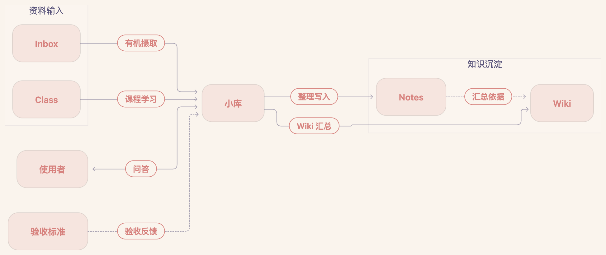

# KnowledgeHub

> 中文版：[README.md](README.md)

KnowledgeHub is an evolving knowledge base powered by Obsidian + Codex. Raw material is organized into topic notes, learning guides, and reusable concepts, then improved through questions, feedback, and new evidence.

This manual is for new users: copy this repository, add your own content, and turn it into your own knowledge base.

## What Is This

The knowledge base follows the LLM Wiki idea: users collect, ask, and judge; Codex retrieves, organizes, links, and proposes updates. Answers start with existing notes and knowledge pages, consulting original sources when needed.

## Harness Architecture

Rule files guide XiaoKu, the assistant configured in `AGENTS.md`. Changes are written within the user's explicit authorization, checked against the acceptance criteria, and reused in later questions.



## Quick Start

1. Open this directory as a Vault in Obsidian.
2. Edit `AGENTS.md` and replace the personal information with your own.
3. Put your first piece of material into `Inbox/`.
4. Ask Codex to follow `AGENTS.md` and `INGESTION.md`, prepare a draft, and list exact file actions. It executes within existing explicit authorization and requests approval for anything outside that scope.
5. Ask questions based on `Wiki/` and `Notes/`. Codex checks the available evidence and states what is missing or has not been checked.

## Directory Structure

| Directory | Responsibility |
| --- | --- |
| `Inbox/` | New captures and unprocessed raw material; processed material is archived to `Inbox/archive/` |
| `Notes/` | Learning notes and personal study outputs, grouped by topic; detailed explanations, derivations, figures, and evidence |
| `Wiki/` | `Theme/` holds topic learning guides and synthesis; `Items/` holds reusable cross-topic concepts |
| `Ideas/` | Inspiration, reflections, and thinking |
| `Class/` | Courses currently being studied |
| `Outputs/` | Unorganized legacy material |
| `assets/` | Media resources such as images |
| `AGENTS.md` | Top-level rules, permissions, and links to workflow rules; read-only unless the user authorizes a change |

## Core Workflows

1. **Organic ingest**: read `Inbox/` material, compare it with existing knowledge, and propose merging, creating a note, or deferring. Write approved notes under `Notes/<topic>/`; archive originals to `Inbox/archive/` only after successful processing and approval of the archive action.
2. **Topic learning guides**: `Wiki/Theme/<topic>.md` organizes the learning path, mechanisms, internal relationships, conflicts, external connections, and gaps. Update it only when there is a meaningful topic change and the Wiki action is authorized.
3. **Study and practice**: organize course material and practical experience into learning notes, merging relevant explanations and evidence into existing notes where appropriate. `LEARNING.md` is a reserved course-workflow entry; its details are still pending.
4. **Q&A write-back**: answer the current question first. Propose a knowledge update only when the conversation adds reusable explanations, evidence, corrections, or connections; write within the approved scope.
5. **Cross-topic concepts**: evaluate reusable concepts as `Wiki/Items/` candidates, checking existing pages, evidence, and conceptual boundaries. Creation requires approval by default, and new pages start as `status: draft`.

## Use Cases

**Daily collection and retrieval**

Drop articles, web pages, and ideas into `Inbox/`, then ask Codex questions when needed. Answers start with the organized knowledge layer, trace relevant claims back to their sources, and identify evidence gaps.

**Deep dive into a topic**

Keep accumulating around one direction. When new material changes the learning path or understanding of a topic, propose an update to its learning guide. The guide brings together learning steps, mechanisms, internal synthesis, external connections, and gaps to help decide what to study next.

**Project and experience accumulation**

Capture project retrospectives, experiment logs, and failure cases in `Inbox/`, then organize them into `Notes/` within the approved scope. Keep the decisions, implementation anchors, evidence, and applicability limits available for similar problems later.

**Cognitive review and feedback**

Ask Codex to inspect relevant topics for connections, conflicting claims, outdated evidence, and gaps. Review results are candidate maintenance actions; approved changes improve the corresponding notes or knowledge pages.

**Output and sharing**

Use topic learning guides and concept pages as a base for articles, talks, or topic digests. New explanations or evidence from writing can become approved updates to the relevant notes.

**Cross-domain connection**

When a concept has a clear boundary, supporting evidence across topics, and future reuse value, propose a `Wiki/Items/` page. Explain both the shared mechanism and the conditions that differ between topics; mark analogies and potential applications as such.

## Usage Tips

- Ingest one piece at a time; optimize the loop before batching.
- Install the official Obsidian Web Clipper for web material: set the save location to `Inbox` and use `{{date|date:"YYYY-MM-DD"}} - {{title}}` as the note name so clippings land in the collection area and filenames are recognizable by Codex. After clipping, use the shortcut to download images into local `assets/`.
- Build `Wiki/Theme/` topic manuals first before adding advanced retrieval; a small vault does not need a vector database.
- Run health checks regularly: contradictions, stale conclusions, orphan pages, broken links, and high-value Q&A that has not been written back.
- Capture practical experience and retrospectives in `Inbox/`, then propose merging them into relevant `Notes/` pages.

## Usage Examples

**Collect**

Save an article, web page, or idea as Markdown into `Inbox/`, preferably with a date in the filename:

```text
Inbox/2026-08-05 - Article title.md
```

**Ingest one piece with Codex**

```text
Please ingest Inbox/2026-08-05 - Article title
```

Codex first compares the material with existing knowledge, prepares a draft, and lists exact file actions. Within the approved scope, it merges or creates a note, checks the result, and archives successfully processed originals. Wiki updates require a meaningful topic change and authorization covering those pages.

**Ask Codex**

```text
Please answer based on Wiki/ and Notes/: what is the difference between X and Y?
```

Answers cite relevant notes and knowledge pages and consult original sources when needed. If no support is found, Codex states the search scope and evidence gap; any external information or added explanation is identified separately.

**Organize course or practical material**

```text
Please organize Class/<course>/<material> and my practical findings into Notes/<topic>/.
First prepare a draft and list the exact file actions.
```

Codex checks existing notes for the same source or question, then proposes a merge or a new note while preserving explanations and evidence. It follows the approved scope; updates to `Wiki/Theme/<topic>.md` are proposed only when the topic changes. Course-workflow details in `LEARNING.md` are still pending; content quality is checked against `CRITERION.md`.

**Run a health check**

```text
Please scan Wiki/ and Notes/ for contradictions, stale conclusions, orphan pages, broken links, and gaps
```

The results are candidate maintenance actions; writes still require your explicit approval.

## Rules

- [`AGENTS.md`](AGENTS.md) defines identity, directory responsibilities, permissions, and rule entry points. Codex does not modify it without permission.
- [`INGESTION.md`](INGESTION.md) covers organic ingest; [`GATHER.md`](GATHER.md) covers topic synthesis and Items; [`Q&A.md`](Q&A.md) covers retrieval, answers, and write-back; [`CRITERION.md`](CRITERION.md) defines acceptance criteria. [`LEARNING.md`](LEARNING.md) is the reserved course-workflow entry, with details pending.
- Writes to `Notes/`, `Wiki/`, and `Ideas/` require explicit authorization for precise files and content. Existing authorization is reused within its scope; approval for Notes does not extend to Wiki, Ideas, or rule changes.
- Notes keep source references, explanations, derivations, examples, and figures. Local sources are linked in the body as well as recorded in `source_refs`.
- Image paths use forward slashes `/`; check local paths from the note's location and preserve original external image URLs. Math formulas use `$...$` / `$$...$$`.
- Passing format or content checks does not automatically establish `verified` status or mean the user has learned the material. Learning progress remains under the user's control.
