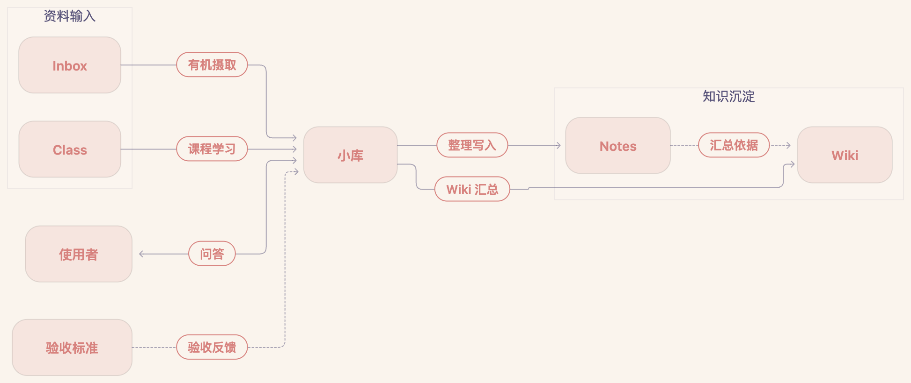

# KnowledgeHub

> English version: [README.en.md](README.en.md)

KnowledgeHub 是一个由 Obsidian + Codex 驱动的可进化知识库。原始素材被整理为主题笔记、学习路线和可复用概念，再通过提问、反馈与新证据持续完善。

本说明书面向新使用者：复制本仓库后，加入你的个人内容，把它变成你自己的知识库。

## 这是什么

知识库采用 LLM Wiki 的思路：使用者负责收集、提问与判断，Codex 负责检索、整理、关联与提出更新。回答优先基于已有笔记和知识页，必要时回查原始来源。

## Harness 架构

规则文件约束小库（`AGENTS.md` 中配置的助手）执行任务。变更在使用者明确授权的范围内写入，按验收标准核对，再供后续提问检索复用。


## 快速开始

1. 用 Obsidian 打开本目录，作为 Vault。
2. 编辑 `AGENTS.md`，把“我是谁”部分改成你自己的信息与目标。
3. 往 `Inbox/` 放第一篇素材。
4. 让 Codex 按 `AGENTS.md` 和 `INGESTION.md` 准备草稿、列出精确文件动作；已有明确授权的范围直接执行，未覆盖的部分先申请批准。
5. 基于 `Wiki/` 和 `Notes/` 提问；Codex 核对已有证据，并说明缺失或尚未核对的内容。

## 目录结构

| 目录 | 职责 |
| --- | --- |
| `Inbox/` | 新捕获、未整理的原始素材；已整理素材归档至 `Inbox/archive/` |
| `Notes/` | 按主题组织的学习笔记与个人学习产物，保留详细解释、推导、图文和证据 |
| `Wiki/` | `Theme/` 承担主题学习导航与综合，`Items/` 保存跨主题复用概念 |
| `Ideas/` | 灵感、感悟、思考 |
| `Class/` | 正在学习的课程 |
| `Outputs/` | 尚未整理的旧资料 |
| `assets/` | 图片等媒体资源 |
| `AGENTS.md` | 顶层规则、权限与流程规则入口；未经使用者允许不修改 |

## 核心工作流

1. **有机摄取**：阅读 `Inbox/` 素材，与已有知识比较，提出融合、新建或延后的方案。获批笔记写入 `Notes/<主题>/`；只有成功整理且归档动作获批的原件才移入 `Inbox/archive/`。
2. **主题说明书**：`Wiki/Theme/<主题>.md` 组织学习路线、核心机制、内部关系、冲突、外部连接与缺口。只有实际改变主题理解且 Wiki 动作获授权时才更新。
3. **学习与实践整理**：把课程材料和实践经验整理为学习笔记，优先将相关解释与证据融入已有笔记。`LEARNING.md` 已预留课程流程入口，具体细则仍待补充。
4. **问答回流**：先回答当前问题；只有新增可复用的解释、证据、纠错或连接时才提出回流候选，并在获批范围内写入。
5. **跨主题概念**：检索已有页面，核对证据与概念边界，再评估 `Wiki/Items/` 候选。默认经批准后创建，新页设为 `status: draft`。

## 使用场景

**日常收集与检索**

把看到的文章、网页、灵感放进 `Inbox/`，需要时向 Codex 提问。回答优先从已整理的知识层出发，回查相关来源，并指出证据缺口。

**主题深度学习**

围绕一个方向持续积累。新材料改变主题的学习路线或理解时，再提出主题说明书更新；学习步骤、核心机制、内部综合、外部连接与缺口集中在同一页，帮助判断下一步学什么。

**项目与经验沉淀**

把项目复盘、实验记录、失败案例先捕获到 `Inbox/`，再在获批范围内整理进 `Notes/`。保留决策、实现锚点、证据和适用边界，供之后遇到类似问题时复用。

**认知复盘与反馈**

按需让 Codex 检查相关主题的关联、观点冲突、陈旧证据与缺口。检查结果先作为维护候选，获批后再完善对应笔记或知识页。

**输出与分享**

需要写文章、做分享或整理专题时，可以基于主题说明书和概念页成稿。写作中新形成的解释或证据，可提出融入相关笔记的候选，经批准后回流。

**跨领域连接**

概念边界清晰、具备跨主题证据且有未来复用价值时，可提出 `Wiki/Items/` 候选。说明共同机制与不同主题的适用条件，类比和潜在应用应明确标注。

## 使用建议

- 一次只摄取一篇素材，跑通再批量处理。
- 网页素材建议安装 Obsidian 官方 Web Clipper：在插件设置里把保存位置设为 `Inbox`，笔记名用 `{{date|date:"YYYY-MM-DD"}} - {{title}}`，这样剪藏会直接进入收集区，且文件名可被 Codex 识别。剪藏后可用快捷键把图片下载到本地 `assets/`。
- 先建立 `Wiki/Theme/` 主题说明书，再谈复杂检索；小规模时不需要向量数据库。
- 定期做知识库健康检查：矛盾、陈旧结论、孤立页、断链与待回写的高价值问答。
- 把实践经验和复盘先捕获到 `Inbox/`，再提出融入相关 `Notes/` 笔记的方案。

## 使用示例

**收集**

把网页、文章或想法直接存成 Markdown 放进 `Inbox/`，文件名建议带日期：

```text
Inbox/2026-08-05 - 文章标题.md
```

**与Codex对话，摄取一篇素材**

```text
请摄取 Inbox/2026-08-05 - 文章标题
```

Codex 先与已有知识比较，准备草稿并列出精确文件动作；在获批范围内融合或新建笔记、复核内容，并归档成功整理的原件。Wiki 更新需要有主题增量，且授权覆盖对应页面。

**询问Codex**

```text
请（基于 Wiki/ 和 Notes/） 回答：XX 和 YY 有什么区别？
```

回答引用相关笔记和知识页，必要时回查原始来源。未找到支持时，明确说明检索范围与证据缺口；外部补充和新增解释应单独说明。

**整理课程或实践材料**

```text
请将 Class/<课程>/<材料> 与我的实践结果整理到 Notes/<主题>/。
先准备草稿，列出精确文件动作。
```

Codex 检索同一来源或问题的已有笔记，再提出融合或新建方案，保留解释和证据。执行遵循获批范围；只有主题理解改变时才提出 `Wiki/Theme/<主题>.md` 更新。课程流程细则仍待补充，内容质量按 `CRITERION.md` 核对。

**做一次健康检查**

```text
请扫描 Wiki/ 和 Notes/，检查矛盾、陈旧结论、孤立页、断链与缺口
```

检查结果只作为候选维护动作，写入仍需你明确批准。

## 规则说明

- [`AGENTS.md`](AGENTS.md) 规定身份、目录职责、权限与规则入口，Codex 未经允许不修改。
- [`INGESTION.md`](INGESTION.md) 规定有机摄取；[`GATHER.md`](GATHER.md) 规定主题汇总与 Items 管理；[`Q&A.md`](Q&A.md) 规定检索、回答与回流；[`CRITERION.md`](CRITERION.md) 规定验收标准。[`LEARNING.md`](LEARNING.md) 是预留的课程流程入口，细则待补充。
- 写入 `Notes/`、`Wiki/`、`Ideas/` 需要明确授权，覆盖精确文件与内容范围；已有授权在其范围内复用，批准 Notes 不自动扩大为批准 Wiki、Ideas 或规则修改。
- Notes 保留来源、解释、推导、例子与图；本地来源同时维护 `source_refs` 和正文来源链接。
- 图片路径统一使用正斜杠 `/`，从笔记所在位置核对本地路径，外链图片保留原始 URL；公式使用 `$...$` / `$$...$$` 包裹。
- 格式或内容检查通过，不会自动成为 `verified`，也不代表使用者已经学会；学习进度由使用者维护。
